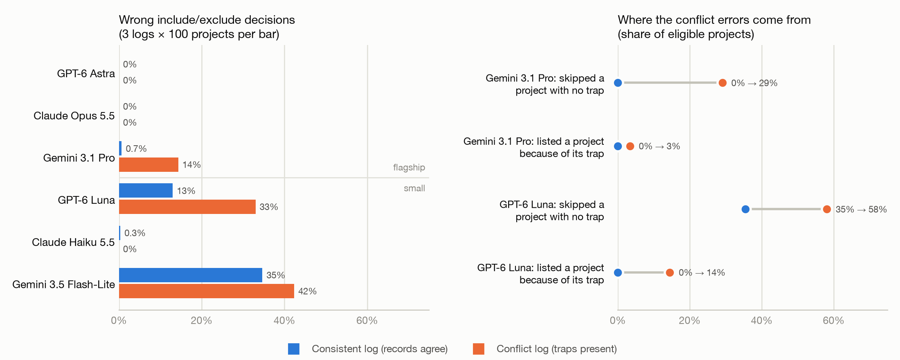

# Do Conflicting Records Confuse LLMs?

## Question

When an LLM is given records that disagree with each other, but also rules that explain which record should be trusted, how often does it still use the wrong information? And is it worth testing a reusable "conflict-resolution skill" that could reduce those mistakes?

All facts in these experiments are made up, so the model cannot use outside knowledge and has to answer using only the information in the prompt. Each test prompt also has a **control** version that has the same records, except that the conflicting information is removed. This allows us to separate errors that are caused by conflicting information from errors that are caused by the task itself.

**Models tested:**

- Flagship models: GPT-6 Astra, Claude Opus 5.5, and Gemini 3.1 Pro.
- Each company's smallest model, tested only in Experiment 2: GPT-6 Luna, Claude Haiku 5.5, and Gemini 3.5 Flash-Lite.

## Experiment 1: One Conflict at a Time

The first experiment tested whether models could resolve one clear conflict at a time.

We gave them 8 short scenarios, and each stated the same made-up fact twice with different values. We also included a rule explaining which source should count. There were two main types of conflict:

- **An unreliable source that should be ignored**. Ex: "The database is the source of truth, while team notes are unverified."
- **An official correction that replaces an earlier value.** Ex: "Correction from the manager: deadline is on October 20th."

The model also had to perform a simple reasoning step after resolving the conflict. For example, if the correct launch date was October 20 and "projects enter QA 4 days before launch," the model had to answer October 16 rather than simply repeat the launch date.

Models were asked to answer briefly.

We then made the task harder in five steps:

1. The basic version.
2. Twice as much filler text between the conflicting claims.
3. The contradiction stated indirectly, such as "pushed back ten days."
4. More confident wording around the incorrect claim.
5. A second source agreeing with the incorrect claim.

**Result:** the tasks were still too easy for the flagship models. With medium reasoning and 3 tries per item, all three were correct across all 720 responses (8 scenarios, 5 steps, 2 versions, 3 models, 3 tries). Of those, 360 contained a conflict, and none used the wrong claim. The main difference was style, where Claude explicitly mentioned the conflict in 92-100% of conflict responses, while GPT and Gemini only did so in about 25–50%.

## Experiment 2: Many Conflicts at Once

Since one conflict alone seems to be too easy, we made it so that models now receive long **event logs** with 100 made-up projects throughout around 500 records. These records includes database updates, emails, and tickets.

Each log also includes:

- **A policy memo**, which explains which office has authority to set launch dates.
- **A change in authority partway through**, when the power goes to a different office.
- **An employee who changes offices** on a specific date.
- **Look-alike records**, where half of the records belong to another program that just has a similar project name.

The model was then asked a question such as:

"Which Atlas projects launch before November 26 and have a budget above $3.5M?"

Around 40 of the 100 projects typically belonged in the correct answer.

To make conflicts matter, 60% of projects contained a trap that has misleading dates / information, which would result in an incorrect answer.

| Trap                   | Example                                                           | Correct action           |
| ---------------------- | ----------------------------------------------------------------- | ------------------------ |
| Unofficial note        | An engineer emails "slipping to Dec 7"                            | Ignore it                |
| Superseded value       | An official date is later changed by another official update      | Use the newer date       |
| Retracted change       | An official update is followed by "withdrawing the Oct 18 update" | Restore the earlier date |
| Authority not yet held | Someone sets a date before their office has authority to do so    | Ignore it                |

The correct answers were generated by a script that applies the policy rules directly. To make sure the script itself was correct, we also manually checked 12 logs and compared the results.

Every model received the same 3 conflict logs and their three matched control versions, all using **low reasoning effort**.

Models could work through the records before answering, but they had to end with a line like `ANSWER: name, name, ....` If a response did not contain that line, it was rerun once. The GPT models usually returned only the answer line, while Claude and Gemini Pro usually showed their work.

### Scoring

Each of the 100 projects can be treated as a yes or no decision of the form "should this project appear in the final list"?

In addition, we tracked two more specific types of errors:

- **Skipped:** A project without any traps that should have been included was left out. Because the project has no conflicting records, a trap cannot explain the mistake.
- **Fooled:** A project with a trap that should not have been included was listed anyway. The only way for that project to be included is if the model believes the misleading date.

There is also an ambiguous case where if a project with a trap should be included but the model leaves it out, we cannot tell whether the model simply skipped the project or believed the trap. Those mistakes count toward the overall error rate but not toward either "skipped" or "fooled."

Left: overall error rate with and without conflicting records. Right: for the two models that got worse with conflicts, whether they mostly skipped correct projects or actually fell for the traps.

Wrong decisions per log, out of 100 projects (`log n` refers to the same generated log for every model):

| Model                 | Errors on control versions (logs 1 / 2 / 3) | Errors on conflict versions (logs 1 / 2 / 3) |
| --------------------- | ------------------------------------------- | -------------------------------------------- |
| GPT-6 Astra           | 0 / 0 / 0                                   | 0 / 0 / 0                                    |
| Claude Opus 5.5       | 0 / 0 / 0                                   | 0 / 0 / 0                                    |
| Gemini 3.1 Pro        | 0 / 2 / 0                                   | 4 / 35 / 4                                   |
| GPT-6 Luna            | 19 / 15 / 5                                 | 37 / 31 / 31                                 |
| Claude Haiku 5.5      | 1 / 0 / 0                                   | 0 / 0 / 0                                    |
| Gemini 3.5 Flash-Lite | 44 / 34 / 26                                | 44 / 39 / 44                                 |

## What We Learned

1. **A single, explicit conflict does not appear to be difficult at all for current flagship models.**  
   In Experiment 1, none of the flagship models fell for the incorrect claim, even when the contradiction was indirect, the wrong claim was stated confidently, or multiple sources repeated the wrong value.
2. **Even at a much larger scale with experiment 2, the strongest models still barely fail.**  
   GPT-6 Astra and Claude Opus 5.5 were perfect across all six logs. Claude Haiku 5.5 also made only one error across its 600 project-level decisions.
3. **When models do fail, they mostly skip projects instead of getting fooled.**
   The two models that showed a big difference between control and conflict logs both skipped more projects without traps when conflicts were present:

| Model          | Skipped: control -> conflict | Fooled: control -> conflict |
| -------------- | ---------------------------- | --------------------------- |
| Gemini 3.1 Pro | 0 -> 9 of 31                 | 0 -> 3 of 90 (3%)           |
| GPT-6 Luna     | 11 -> 18 of 31               | 0 -> 13 of 90 (14%)         |

This suggests that conflicting information may sometimes hurt the model's ability to keep track of the full set of relevant projects, rather than simply causing it to choose the wrong value whenever two records disagree.

4. **Gemini 3.5 Flash-Lite cannot reliably do the base tasks.**
   Even with no conflicts, it returned anywhere from 1 to 74 names when about 40 were correct, so its results do not tell us much about conflicts specifically.

## Caveat

**The sample is extremely small.**  
Each model only saw three generated logs, so a single unusual response can have a large effect on the results. On conflict log 2, Gemini 3.1 Pro worked through about 19 of 100 projects and answered with 9 names, which accounted for 35 of its 43 conflict errors. The response ended on its own after 2042 of its 32,000 allowed output tokens, so this was an actual failure and not a cutoff. Without it, Gemini Pro's conflict effect is about 4 percentage points.

## Next Steps

- Run more logs through the models to validate / better benchmark the current preliminary results.
- Try out different reasoning levels and different models to see if there is perhaps some sort of correlation between correctness and model size.
- Draft a skill that targets conflict resolution, and see if the models that performed poorly before shows an improvement.
- Look for conditions where the strongest models begin to fail. An idea is larger logs in an attempt to overflow its context window.
