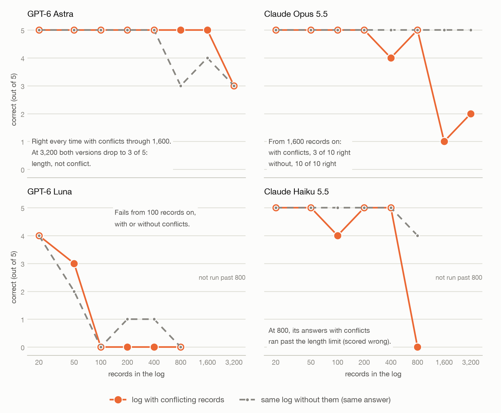

# Do Conflicting Records Confuse LLMs?

Week 3-4 Progress

## The test

We gave AI models a log of records about a made-up project's budget and asked one question: **what is the budget now?** The rules come with the log:

- Only the **Finance Office** can change the budget. Messages from anyone else are gossip and don't count.
- The Finance Office can **withdraw** one of its earlier changes, which cancels it. A withdrawal can itself be withdrawn.

A short example:

```
#001  Finance Office:     Kavel budget set to $800K.
#002  Engineering email:  Kavel budget is going up to $950K.    <- gossip, ignore it
#003  Finance Office:     Kavel budget increased by $40K.       <- cancelled by #005
#004  Finance Office:     Kavel budget decreased by $15K.
#005  Finance Office:     Withdraw update #003.
#006  Finance Office:     Kavel budget increased by $25K.

What is Kavel's budget now?   Answer: $800K - $15K + $25K = $810K
```

We made logs from 20 to 3,200 records long. Every log came in two versions:

- **With conflicts:** gossip and withdrawals mixed in, as above.
- **Without conflicts:** the gossip, the withdrawals, and the changes that got withdrawn are swapped for harmless messages. The changes that count, and the answer, stay the same.

The example above, without conflicts:

```
#001  Finance Office:     Kavel budget set to $800K.
#002  Engineering email:  Kickoff moved to Building 4.
#003  Finance Office:     Invoice batch archived.
#004  Finance Office:     Kavel budget decreased by $15K.
#005  Finance Office:     Quarterly audit scheduled for Friday.
#006  Finance Office:     Kavel budget increased by $25K.

What is Kavel's budget now?   Answer: $810K (same as before)
```

Both versions are equally long and end at the same answer from the same changes. The only extra work in the first version is ignoring the gossip and undoing the withdrawals, so if a model does worse there, that is what tripped it up.

We tested two frontier models, **Claude Opus 5.5** and **GPT-6 Astra**, and two smaller ones, **Claude Haiku 5.5** and **GPT-6 Luna**, on 5 different logs at each length. The smaller models were tested up to 800 records.

## What we found



_Correct answers out of 5 (log scale). Solid lines: logs with conflicts. Dashed lines: the same logs without conflicts._

**1. Short and medium logs are easy for the frontier models.** Up to 800 records, Claude Opus and GPT-6 Astra answered 117 of 120 questions correctly, with or without conflicts.

**2. On long logs, Claude Opus fails, but only when the records conflict.** At 1,600 and 3,200 records:

| Claude Opus 5.5            | Answered correctly                             |
| -------------------------- | ---------------------------------------------- |
| Log with conflicts         | **3 of 10** (1 of 5 at 1,600, 2 of 5 at 3,200) |
| Same log without conflicts | **10 of 10**                                   |

The logs were just as long and had the same answer. The only difference was the gossip and the withdrawals.

**3. GPT-6 Astra slowly loses count, with or without conflicts.** It never got fewer than 3 of 5 right. Its few misses started around 800 records and showed up in both versions: 2 of 5 wrong without conflicts at 800, and 2 of 5 wrong in both versions at 3,200. For GPT, length is the problem, not the conflicts.

So the two frontier models break in different ways: **Claude fails on the conflicts; GPT slowly loses count either way.**

**4. Smaller models fail much sooner.** GPT-6 Luna got almost nothing right from 100 records on, with or without conflicts. Claude Haiku 5.5 held up through 400 records. At 800, it got 4 of 5 right without conflicts, but its answers to the logs with conflicts ran too long to finish, so all 5 count as wrong. Even if they had been allowed to finish, only 1 of the 5 would have been right.

## An example: giving up and using the gossip

On one 3,200-record log, Claude Opus did not finish the work. It wrote:

> I could not work through this record set reliably, so the figure below is an estimate. [...] The non-Finance messages near the end carry no weight, but they sit in roughly the \$1,900K–\$2,550K range. [...] The rough trend of Finance Office changes in that period points to about the middle of that range.

It answered **\$2,200K**; the right answer was **\$2,195K**. That was close, but only by luck. The model itself said those messages don't count, then guessed from them anyway.

## What this does and doesn't show

- **The numbers are small.** Each point is 5 logs, so one miss moves it 20 points. The clearest signal is Claude's 3 of 10 versus 10 of 10.
- **The mistakes are small.** Most wrong answers were off by \$5K to \$150K, about the size of a single change in the log. No wrong answer matched what you would get by believing the gossip, so the withdrawals are the likely cause. Testing each on its own is the next step.
- **How the models were run.** They ran through their own apps (Claude Code and Codex) at low reasoning effort, not through the paid API. They could not run code or use tools, and we checked that none of the responses did.
- **Gemini is not included** since I can't figure out a good way to link it to my subscription.

## Next

- Test gossip-only and withdrawals-only logs separately, to see which one causes the failures.
- Go back to the original question: does a conflict-resolution instruction help Claude on the long logs where it fails?
